# Ejercicio 19 - Condicionales combinados

## Código Python

```python
# Condicionales combinados

edad = int(input("Ingrese su edad: "))

if 0 < edad < 100:     
    print("Edad correcta")
    if edad >= 18:
        print("Es mayor de edad")
    else:
        print("Es menor de edad")   

else:
    print("Edad incorrecta")   


```

## Diagrama de flujo



[Ver o descargar el diagrama en PNG](19_Condicionales_Condicionales_combinados_1.png)

---

[Ver archivo Python original](19_Condicionales_Condicionales_combinados.py)
